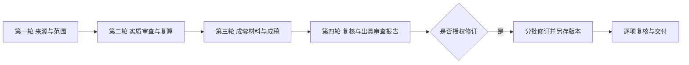

# Report-Review

**用于 Codex 的可行性研究报告审查技能**

[](SKILL.md)
[](LICENSE)

适用于政务信息化、工程建设和技术改造项目。可用于正式报审前的全面审查，也可单独核对投资、进度、支撑材料或文字质量。

## 能做什么

| 审查重点 | 核查内容 |
| --- | --- |
| 建设范围与技术方案 | 对照现状、建设清单、资源配置、容量测算和交付范围，定位跨章节的口径差异。 |
| 投资估算与费用明细 | 逐级核对任务量、单价、取费基数、预备费、分项金额和总额，追查正文与表格中的旧值。 |
| 进度、绩效与验收 | 倒排采购、实施、试运行、整改和竣工验收，检查绩效指标能否由实际成果验证。 |
| 报审材料与流转 | 检查支持正文结论的材料是否齐备，标出需要确认流转范围的信息。 |
| 成稿与修后复核 | 核对错字、交叉引用、图表数据和重复说明，按授权分批修订并抽查版面。 |

审查清单会给出**问题位置、发现依据、影响和处理建议**，并标明哪些可以直接修正、哪些需要用户决定、哪些依赖外部材料。审查类请求默认只读。全面审查结束后默认交付独立的 Markdown 审查报告，也可按要求提供 Word 或 PDF。

## 安装

将仓库克隆为 Codex 用户技能目录下的 `report-review` 文件夹。

**Windows · PowerShell**

```powershell
git clone https://github.com/isunky/sk-report-review.git "$HOME/.codex/skills/report-review"
```

**macOS / Linux**

```bash
git clone https://github.com/isunky/sk-report-review.git ~/.codex/skills/report-review
```

如果配置了自定义 `CODEX_HOME`，将目标目录改为该目录下的 `skills/report-review`。已通过 Git 安装的版本可在对应目录运行 `git pull --ff-only` 更新。

## 使用示例

**正式报审前审查**

> `$report-review` 请审查这份可研及配套材料，列出影响正式报审的问题、需要我确认的口径和建议补齐的附件。先审查，暂不修改文件。

**核对投资细项**

> `$report-review` 以我确认的费用表为准，核对总论、各系统方案、投资明细和付款计划。先给差异表，并标明旧金额出现的位置。

**分批修改与复核**

> `$report-review` 按已确认的清单修复第一批问题。保留原件，另存新版本。完成后逐项核对正文、表格和嵌入图。

## 工作流程



## 仓库内容

- [SKILL.md](SKILL.md) · 技能定义、审查顺序和交付要求
- [复杂修订复核指南](references/revision-review.md) · 数据溯源、费用勾稽、流转审查和图表复核
- [审查报告模板](references/review-report.md) · 审查范围、总体结论、问题台账和处理顺序
- [Codex 界面配置](agents/openai.yaml) · 技能显示名称和简介

按 [Apache License 2.0](LICENSE) 授权。

## 版本发布

稳定版本及安装包见 [GitHub Releases](https://github.com/isunky/sk-report-review/releases)。下载 `report-review-vX.Y.Z.zip`，将其中的 `report-review` 目录放到 Codex 的用户技能目录下。

维护者先更新 `VERSION` 并提交，再推送与文件内容对应的 `vX.Y.Z` 标签。GitHub Actions 会检查版本号、打包技能并发布 Release。
